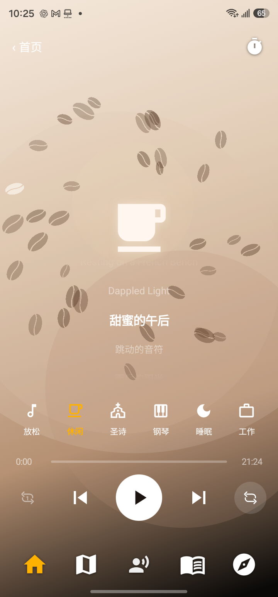

# AskBible.me 音乐续播与 Android 顶栏验收

实现和设备验收已完成；用户随后授权三个平台发布，最新状态见 [发布记录](release/README.md)。网页完整生产构建及构建产物的本地启动检查也已通过，详见 [补充构建验收](build-verification/README.md)。以下记录保留实现阶段的验证证据。

## 改动

- 原生 iOS / Android 按稳定曲目 ID 保存进度、循环方式、播放意图和睡眠截止时间。每两秒保存，暂停、选曲、拖动和退到后台也保存。重开接回同一首；原来暂停就保持暂停，已到期的睡眠定时不会自动开播。
- 首页增加轻量的「下一首」「选音乐」入口；音乐页使用原有专辑、曲目列表及传输控件。
- Web 移除进入音乐页及重新打开首页音乐时的随机换曲，修复专辑内下标与曲库下标混用、暂停换曲的旧进度显示，以及相同音源重新播放请求未生效的问题。恢复覆盖直接打开音乐页及首页。
- 没有历史选择时，仅默认安静专辑；恢复用户主动选择的其它专辑。
- Android 音乐页的返回与定时器改为同一行、同一安全区、50dp 点击高度；返回文字左边约 16dp，去掉原来的 136dp 固定居中宽度。睡眠模式隐藏控件时，两者同步隐藏。
- 未改音源地址、R2 配置、账号/云端数据，也未修改 Cabinet-X。

## 验证

| 检查 | 实际结果 |
| --- | --- |
| iOS 模拟器 Debug 构建 | 成功；安装于 iPhone 17 Pro / iOS 26.5 模拟器 |
| Android Debug 构建 | 成功；包含最后的顶栏修正 |
| Swift 状态回归 | 通过序列化、稳定 ID、删除歌曲、损坏存储、边界进度、暂停及睡眠到期断言 |
| Kotlin 状态回归 | 7/7 通过，JUnit XML 已保存 |
| Web / 共享策略 Vitest | 26/26 通过，5 个文件；其中 Expo 目录的现有纯函数仅作共享策略回归，不代替原生验收 |
| TypeScript | `tsc --noEmit` 通过 |
| Web 完整生产构建 | 使用当前源码的独立快照执行 `npm run build`，含全部 prebuild；61 秒完成，退出码 0 |
| Web 生产产物启动 | `/music`、`/web`、生成的经文与交叉引用均返回 200；27 个页面引用的 JS 文件全部可读取 |
| 任务文件空白检查 | `git diff --check` 通过 |
| iOS Maestro | 打开音乐、冷启动续播、暂停后重开、暂停状态下一首、切换专辑、快速连续下一首、首页下一首，全部通过 |
| Android Maestro | 三星 S23 Ultra 真机；上述播放路径全部通过；最后一版顶栏的定时弹层、返回首页、再进入音乐页也通过 |
| Android 运行日志 | 最后 QA 进程日志中无 `FATAL EXCEPTION` |
| Chrome 实际路径 | 首页关闭再打开同一首由 118.501368 秒续至 118.787419 秒；暂停重载保持同一首 124.842416 秒；下一首和切换专辑正确；390×844 与桌面布局已查看 |

原生截图已查看，暂停重开后 iOS 显示同一首 1:47，Android 显示同一首 2:35，没有回到 0:00。下一首则显示新的歌曲并从 0:00 开始，保持原来的暂停状态。

Android 最终顶栏（已实机点击验收）：

对应流程和完整日志在 `flows/`、`logs/`，截图在 `screenshots/`。

## 平台限制与构建说明

- iOS 使用模拟器，未验证实体 iPhone 的中断、锁屏和后台音频系统行为。Android 使用实体三星手机。
- Android 原有 `me.askbible.native` 的版本号为 251，当前仓库 Debug 为 248，普通覆盖安装被 Android 拒绝降级。未删除原 App 或数据；使用临时 Gradle 初始化脚本构建并安装独立 `me.askbible.musicqa` 包进行验收。QA 包保留在设备上，未替换原有 App。
- Chrome 恢复了歌曲和位置，但自动出声可能被浏览器阻止；测试中点击播放可从恢复点继续。[MDN 自动播放规则](https://developer.mozilla.org/en-US/docs/Web/Media/Guides/Autoplay)。未验证 Safari。
- 最初在原工作区执行 `npm run build` 被 0 字节的可选主题库阻塞，跳过 prebuild 的构建又被 `.env.local` 失效链接阻塞。二者都是被 Git 忽略的本机残留，仍原样保留。
- 后续沿用现有发布脚本的独立目录构建约定，复制当前 Web 源码及依赖，仅载入已有 `.env.web-build.local` 中的三个公开配置项；完整构建和产物启动均已通过。没有改写环境链接、数据库或任何凭据，也没有部署。19 个经文数据库的节数和主题计数核对一致。
- 本机 Node 为 25.9.0，项目声明 22.x；本次使用已有运行时成功构建，未安装或切换运行时。
- 历史 Expo 的全套脚本没有用作原生验收，本次使用实际原生包与对应 Maestro 路径。

## 工作区与交付

仓库 `https://github.com/JoshLabs-app/askbibleme.git`，分支 `claude/tv-page`。工作区原本已有大量其它改动，未提交、推送或部署。

`task-only.patch` 是相对本任务开始时文件快照生成的 21 个源文件补丁，排除了已存在的同文件修改；`task-files.json` 列出源文件。补丁用于审阅及提取改动，当前工作区已经包含这些实现，不要再次直接应用。原有文档空白错误未纳入任务修复。

## 曾被自动审批拒绝的操作

- 向父线程 `01a1a031-0398-703c-9d9c-e34c802f70db` 发送工具状态消息被拒绝：缺少明确的人类跨线程发送授权。未执行、未重试；最终结果由平台通知父线程。
- 对连接的三星手机执行 `wm dismiss-keyguard` 被拒绝：属于未授权绕过锁屏。未执行、未重试。随后 Joshua 自己开屏后，正常进入应用并完成测试，设备阻塞已经解除。
