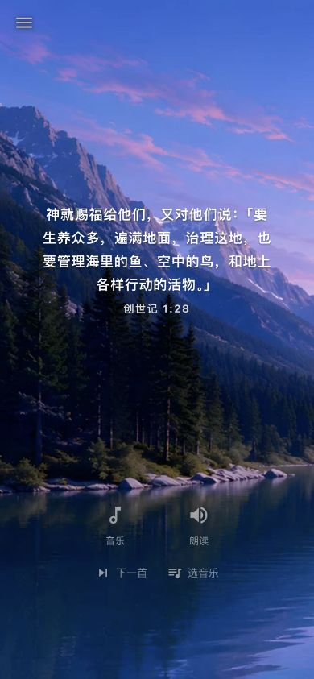

# AskBible.me 音乐更新发布记录

用户授权「发布」「都发」。本次发布只包含音乐续播、首页下一首/选音乐入口、Android 音乐页顶栏对齐及对应版本、测试和更新说明。

| 平台 | 版本 | 核实状态 |
| --- | --- | --- |
| iOS | 1.1.8（141） | 本机签名归档、导出、验证和上传成功；构建 VALID；App Store Connect 为 WAITING_FOR_REVIEW，AFTER_APPROVAL 自动发布 |
| Android | 1.0.55（252） | 已公开上线；2026-11-05 后续核实 Google Play 控制台为最新正式版、100% 推出、无待发布变更；公开页显示 1.0.55 与本次音乐续播更新说明 |
| Web | `66d16329dc3d0cda65f1f55430e64a180180e485` | 已本机预构建并发布到 askbible.me；线上 app-build.json 匹配该提交；首页、音乐页和 27 个脚本均为 200 |

PR：<https://github.com/JoshLabs-App/askbibleme/pull/50>，已按标签与 CI 门禁 squash 合并。实现提交 `96306ac92f79e2d6d610bac9ede17f090292b188`，基于当时最新 main `901776d5937c6c8f74ba6668781987812d6acaf3`。

## 验证与保留边界

- Swift 续播断言、Kotlin 7 条状态回归、Vitest 26/26、完整本地 Web 构建和 GitHub CI 均通过。
- 最终 iOS 模拟器 Maestro 流通过：暂停重开、下一首保持暂停、选专辑与播放。
- 三星真机在实现阶段通过续播、暂停重开、下一首、选专辑、快速下一首、首页入口以及顶栏对齐和定时弹层。发布阶段的最后一次重跑遇到锁屏；未绕过锁屏。最终 Android 播放器、续播状态与音乐页源文件逐字节匹配已通过真机测试的版本，见 `device-tested-source-comparison.json`。
- 最新 main 上合入的 Web 首页保留已有长按、滑动功能。390×844 静音验收通过：下一首、选音乐、暂停切歌、换专辑、重载保留选曲和暂停；浏览器没有控制台错误。
- 浏览器可能要求用户点击播放后才出声，随后从保存位置继续；不能保证每次打开网页自动出声。未验收实体 iPhone 或 Safari。
- 原工作区在 `claude/tv-page` 的无关未提交内容和同文件既有修改均保留；发布使用独立 worktree，仅显式加入 27 个本任务文件，未运行会全量提交的 ship 脚本。未修改 Cabinet-X、凭据、线上数据或 R2 地址。
- 原生当前曲库与已发布 main 保持一致（164 首、当前原生目录无打包 MP3），没有套用历史 Expo 的媒体打包规则或开启 Android PAD。

正式站新部署：`https://askbibleme-h8gu6xiso-joshlabsapp.vercel.app`（`dpl_5Lm4wacNavtVvAp21AhvJJHCZhT7`）。本次没有遇到 Vercel 容量错误。线上 390×844 页面实际检查通过，下一首保持暂停、选音乐导航、重新加载保留选曲均正常，无浏览器控制台错误。为遵从停止声音要求，仅在本次测试标签页暂时阻止音频资源；结束时解除限制、恢复窗口尺寸并关闭所有本任务测试标签页。

## 后台声音

收到「不知道那个在后台播放，帮我关了」后，已终止本任务 iOS 模拟器 AskBible 和 Android `me.askbible.musicqa`。随后核实：QA 进程退出，iOS 主播放器退出，手机原有 AskBible 的各媒体会话为 PAUSED/NONE；网页音频为 paused、背景视频 muted。之后仅做静音验收，没有改变其它应用音量或播放。

## 证据与清理

`ios-review-status.json` 记录审核版本、141 构建关系和自动发布设置；`android-after.json` 与 `android-console-status.json` 分别记录 API 和控制台状态。`uploaded-artifacts.json` 保留成功上传产物的大小和 SHA-256；已删除 IPA/AAB、归档、模拟器派生目录和 Android outputs，保留日志。

先前生产部署保留用于回滚：`https://askbibleme-qlazxn1z5-joshlabsapp.vercel.app`（`dpl_5zzmEptni5AjovpmCP43rTrspXn2`）。未删除 Vercel 部署、未升级套餐。

外部待办：Apple 1.1.8（141）仍 WAITING_FOR_REVIEW，2026-11-05 17:16 UTC 核实；公开 App Store 页面仍为 1.1.7。未发现需要用户处理的审核阻碍。已建立每小时只读跟进，上线或出现需处理的障碍时报告并暂停跟进；不重复提交或更改发布配置。Android 已通过审核并公开上线。

Android 后续检查同时看到非本次发布阻碍的技术提示：DEX 模糊化指标 0%（2027 年 2 月期限）、androidx.fragment:fragment 1.1.0 过时，以及 Android 15 无边框兼容性建议。仅记录，没有在只读跟进中改动代码或商店设置。
